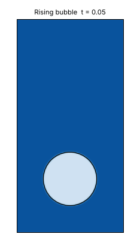
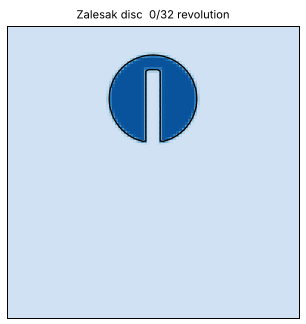
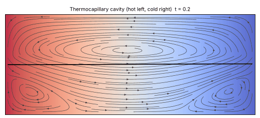

<h1 align='center'>sharpInterFoam</h1>

[](https://github.com/sugurushiratori/sharpInterFoam/actions/workflows/ci.yml)

OpenFOAM solvers for two-phase flows with sharp interfaces, based on a
coupling of the THINC/SW and the S-CLSVOF methods on unstructured meshes.
The code for the paper:
[*Int. J. Microgravity Sci. Appl.*, 38(3) 380301 (2021)](https://doi.org/10.15011/jasma.38.380301)

[日本語版 README](README.ja.md)

#### Efficient Implementation of Two-Phase Flow Solver Based on THINC/SW and S-CLSVOF on Unstructured Meshes<br>
Suguru Shiratori<sup>1,*</sup>,
Takuro Usui<sup>2</sup>,
Shiho Koyama<sup>2</sup>,
Shumpei Ozawa<sup>3</sup>,
Hideaki Nagano<sup>1</sup>,
Kenjiro Shimano<sup>1</sup>
<br>
<sup>1</sup> Dept. Mechanical Systems Engineering, Tokyo City University, Japan <br>
<sup>2</sup> Graduate School of Integrative Science and Engineering, Tokyo City University, Japan <br>
<sup>3</sup> Department of Advanced Materials Science and Engineering, Chiba Institute of Technology, Chiba, Japan

## Solvers

| Solver | Description |
|---|---|
| `sharpInterFoam` | Incompressible, isothermal two-phase flow (interFoam with THINC/SW advection of the volume fraction and an S-CLSVOF level-set function for the interface normal and curvature) |
| `sharpInterThermoFoam` | `sharpInterFoam` with an energy equation and temperature-dependent surface tension (Marangoni / thermocapillary flow) |

Main features

* THINC/SW interface advection on unstructured meshes (oriented flux, explicit update, sub-cycling)
* S-CLSVOF: level-set function from the volume fraction (atanh initial guess and Godunov re-initialisation restricted to a narrow band)
* Surface tension by CSF or by the density-scaled CSF model (balanced with the pressure gradient)
* Mixture density from the volume fraction or from a smoothed Heaviside function of the level set (mass-momentum consistent)
* Temperature-dependent surface tension `sigma(T) = sigma + sigmaTemp*(T - TRef)` in the normal and the tangential (Marangoni) force
* Capillary time-step constraint, contact angle, moving meshes, parallel runs (results independent of the decomposition)

## Examples

| Rising bubble ([Hysing et al. 2009](validation/risingBubble)) | Zalesak disc ([tutorial](tutorials/ZalesakDisc)) |
|:---:|:---:|
|  |  |

<p align="center"><br>
Thermocapillary cavity: temperature, streamlines and interface (<a href="tutorials/thermocapillaryCavity">tutorial</a>)</p>

## OpenFOAM versions

OpenFOAM (ESI / OpenCFD) **v2412** and **v2512**.

## Build

```sh
source <OpenFOAM installation>/etc/bashrc
./Allwmake          # libraries libTHINC, libSCLSVOF and the two solvers
./Allwclean         # remove the build
```

The libraries and solvers are installed in `$FOAM_USER_LIBBIN` and `$FOAM_USER_APPBIN`.

## Usage

Tutorials are in [`tutorials`](tutorials):

| Case | Solver | Content |
|---|---|---|
| `ZalesakDisc/structured`, `ZalesakDisc/unstructured` | sharpInterFoam | Rigid rotation of a slotted disc (paper Sec. 4.1) |
| `dropletDeformation/structured` | sharpInterFoam | Static droplet, spurious currents (paper Sec. 4.2) |
| `thermocapillaryCavity` | sharpInterThermoFoam | Thermocapillary flow in a cavity (paper Sec. 4.3, 400 x 160) |

Each case is run by `./Allrun` (`./AllrunPar` for a parallel run where present) and cleaned by `./Allclean`.

### Parameters

`system/fvSolution`, in the dictionary of the volume fraction:

```
"alpha.water.*"
{
    nAlphaSubCycles 2;

    SCLSVOF                          // level-set function
    {
        correctPsi      yes;         // yes: S-CLSVOF; no: curvature from alpha as in interFoam
        widthFactor     1.5;         // interface half width epsilon = widthFactor * cell size
        densityScaled   yes;         // density-scaled CSF model (for large density ratios)
        densityFunctionHeaviside yes;// mixture density from the Heaviside function (yes) or from alpha (no)
        initializeAtanh yes;         // initial guess psi0 = epsilon/pi*atanh(2 alpha - 1) (yes) or linear (no)
        denomDeltaTau   10;          // pseudo time step of the re-initialisation = cell size / denomDeltaTau
        factorNumLoop   1;           // number of re-initialisation steps = widthFactor*denomDeltaTau*factorNumLoop
        tolMagGradPsi   1e-8;        // relative tolerance of the re-initialisation residual
    }

    THINC
    {
        enable          yes;         // yes: THINC/SW; no: MULES (interFoam)
        epsAlpha        1e-12;       // alpha below epsAlpha or above 1 - epsAlpha: upwind flux
        epsBeta         1e-2;        // lower bound of the THINC steepness; below it the flux is blended with upwind
    }
}
```

`constant/transportProperties`:

```
phases (water air);              // alpha = 1: water
water { transportModel Newtonian; nu 1e-6; rho 1000; }
air   { transportModel Newtonian; nu 1.5e-5; rho 1; }
sigma   0.07;

// sharpInterThermoFoam: transport model NewtonianThermo with the thermal
// diffusivity kappa [m^2/s] and optionally Cp [J/(kg K)] in both phases
// (without Cp: rho*Cp = 1 and the conductivity equals kappa)
sigmaTemp   -1.5e-4;             // d sigma / d T
TRef        293;                 // sigma is the surface tension at TRef (default 0)
```

`system/controlDict`:

```
adjustTimeStep  yes;
maxCo           0.25;
maxAlphaCo      0.25;
maxCapillaryNo  1;               // dt <= maxCapillaryNo * sqrt((rho1 + rho2) h^3 / (4 pi sigma))
```

### Recommendations

* Time scheme `Euler` (Crank-Nicolson breaks the consistency of the mass and momentum transport).
* `adjustTimeStep yes` with `maxCapillaryNo` of 1 or less.
* `interpolationSchemes { default linear; }`; `pointLinear` gives larger spurious currents.
* Many `nOuterCorrectors` with `residualControl` multiply the cost of the level-set re-initialisation; start with one or a few outer correctors.
* Choice of the surface-tension model (`densityScaled`, `densityFunctionHeaviside`):
  * Flows governed by surface tension or Marangoni stresses (capillary
    oscillations, thermocapillary flows): `densityScaled no;` and
    `densityFunctionHeaviside no;`. In the thermocapillary cavity this gives
    the deformation of Sen & Davis, whereas the density-scaled model
    over-predicts it (see [docs/validation.md](docs/validation.md)).
  * Large density ratios with dominant inertia or buoyancy (rising bubbles,
    translating drops): `densityScaled yes;` with `densityFunctionHeaviside yes;`
    keeps the mass and momentum transport consistent.
  * In doubt, compare both settings for your problem.

## Tests and validation

* [`tests/regression`](tests/regression): small regression cases run by the CI (`tests/regression/run.sh`).
* [`validation`](validation): benchmark cases with evaluation scripts; results in [`docs/validation.md`](docs/validation.md).
* [`tests/transposeCheck`](tests/transposeCheck): checks a defect of some OpenFOAM builds (see below).

## Known issues

* Some OpenFOAM builds compute `T()` of a temporary tensor field incorrectly
  (observed with the conda-forge OpenFOAM v2412, gcc 13; the OpenCFD Debian
  packages v2412 and v2512 are correct). The laminar viscous stress of 3D
  cases and of 2D cases in the x-z plane is then wrong in every OpenFOAM
  solver. Run `tests/transposeCheck/Allrun` to check your installation.
* Accuracy limits found in the validation ([docs/validation.md](docs/validation.md)),
  not yet resolved:
  * the viscous damping of capillary oscillations decreases with mesh
    refinement (axisymmetric drop: viscosity recovered from the damping
    -4 % at R/h = 25, -14 % at R/h = 50);
  * with the density-scaled model the thermocapillary deformation is too
    large and grows with mesh refinement;
  * thermocapillary migration of a drop is about 9 % faster than the
    Young-Goldstein-Block velocity.

## Changes from the paper version

See [CHANGELOG.md](CHANGELOG.md). The version used for the paper is tagged `v1.0-ijmsa2021`.

## Citation

```bibtex
@article{Shiratori_IJMSA_2021,
  title   = {Efficient Implementation of Two-Phase Flow Solver Based on {THINC/SW} and {S-CLSVOF} on Unstructured Meshes},
  author  = {Shiratori, Suguru and Usui, Takuro and Koyama, Shiho and Ozawa, Shumpei and Nagano, Hideaki and Shimano, Kenjiro},
  journal = {International Journal of Microgravity Science and Application},
  volume  = {38},
  number  = {3},
  pages   = {380301},
  year    = {2021},
  doi     = {10.15011/jasma.38.380301}
}
```

## License

GNU General Public License v3 (see [COPYING.txt](COPYING.txt)). sharpInterFoam is
derived from OpenFOAM; it is not approved or endorsed by OpenCFD Ltd. or the
OpenFOAM Foundation.
